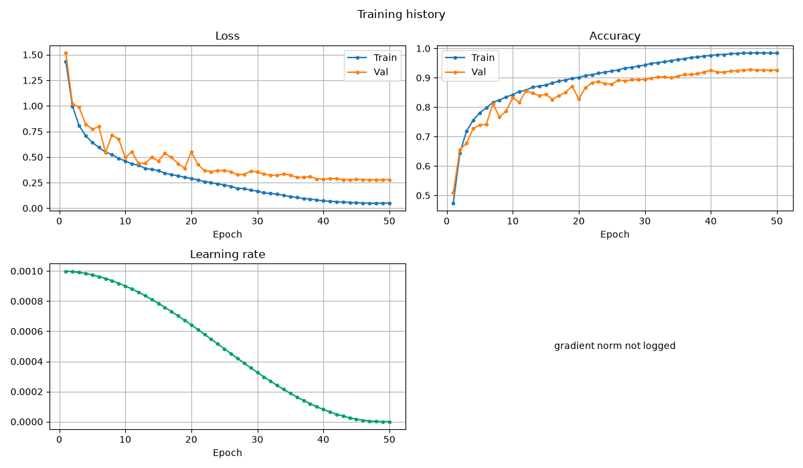

# cnn-classifier

A config-driven, reproducible PyTorch toolkit for CNN image classification.

`cnn-classifier` turns a new image/label dataset into a trained, evaluated, and
reported classifier through a typed YAML configuration. The same library powers
the command line, so a quick smoke test and a full experiment use one pipeline.

## Results at a glance

| Experiment | Result | Budget | Status |
|---|---:|---|---|
| CIFAR-10 scratch baseline | **92.25% test**, 92.78% best validation | 50 epochs, 22.3 min MPS | reproduced |
| ResNet-18 fine-tune, 32×32 | **94.98% test** | 30 epochs, 19.5 min MPS | measured |
| ResNet-18 scratch, 32×32 | 90.88% test | 30 epochs, 19.6 min MPS | measured |
| ResNet-18 linear probe | 62.66% test | 30 epochs, 8.4 min MPS | measured |
| Four core ablations | BN +19.4 pp; cosine +8.5 pp; residual +0.7 pp; augmentation −3.1 pp | 8 epochs, 10k train subset | measured |
| Optical degradation classifier | 85.71% test | 20 epochs, 7.5 s MPS | measured |
| Bring-your-own-data quickstart | contract verified | 2 epochs, under a minute | complete |



Reference: 92.42% validation / 92.61% test on MPS, seed 42. The reproduced test
result is within 0.4 percentage points and clears the ≥90% gate. See the
[results page](https://pengzhao-ai.github.io/cnn-classifier/results/) for the
environment and caveats.

## What is in the core

| Area | What you get |
|---|---|
| Data | torchvision, ImageFolder, CSV manifest, NumPy, and synthetic adapters; 8-bit and 16-bit image I/O; group-safe splits; leakage and duplicate inspection |
| Models | configurable simple CNN, configurable residual CNN, torchvision backbone wrapper, 32×32 stem adaptation, freezing, differential parameter groups |
| Training | callbacks, early stopping, checkpoint/resume, AMP, gradient clipping and accumulation, MixUp/CutMix, EMA, warmup/cosine/step/plateau schedules |
| Evaluation | top-k, per-class metrics, confusion matrices, NLL, calibration (ECE/MCE/Brier), bootstrap intervals, TTA, latency, error analysis |
| Diagnostics | one-batch overfit, shape tracing, gradient reports, determinism checks |
| Artifacts | resolved config, environment and git metadata, data fingerprints, metrics, checkpoints, predictions, figures, model contract |
| Reports | self-contained HTML and Markdown, inline figures, no CDN or network dependency |
| Devices | automatic CUDA, Apple MPS, or CPU selection |

## Install

```bash
make sync
source .venv/bin/activate
cnncls doctor
```

`make sync` installs the package non-editable so the `cnncls` entry point works
reliably on macOS, where an editable `.pth` can be hidden after PyTorch loads.
Run `make sync` again after changing library code. Without activating the
environment, use `uv run --no-sync cnncls ...`.

## Quickstart

Train a tiny deterministic smoke model with no downloads:

```bash
cnncls train -c configs/tests/synthetic.yaml --set training.epochs=1
```

The command creates a run directory under `runs/` containing the resolved
configuration, data fingerprints, model contract, checkpoints, test
predictions, figures, `report.html`, and `report.md`.

Inspect the pipeline before training:

```bash
cnncls inspect-data -c configs/tests/synthetic.yaml
cnncls debug -c configs/tests/synthetic.yaml --overfit-batch --steps 20
cnncls train -c configs/tests/synthetic.yaml --dry-run
```

Evaluate, predict, and rebuild reports from artifacts:

```bash
cnncls evaluate --checkpoint runs/<run>/checkpoints/best.pt --split test
cnncls predict --checkpoint runs/<run>/checkpoints/best.pt --input image.png
cnncls report --run runs/<run>
cnncls compare runs/<run-a> runs/<run-b> --out results/comparison
```

## Demos

| Demo | What it shows | Entry point |
|---|---|---|
| CIFAR-10 scratch | reference residual CNN and the full training path | `python demos/cifar10/scripts/run_scratch.py` |
| Transfer benchmark | scratch vs linear probe vs fine-tune at 32×32 | `python demos/cifar10/scripts/run_transfer.py` |
| Ablations | four controlled pairs on a reduced CIFAR split | `python demos/ablations/run_ablations.py` |
| Optical degradation | manifest data, group-safe splits, confusion analysis | `python demos/optics_degradation/scripts/run_optics.py` |
| Bring your own data | raw-to-intake contract and custom adapters | `python demos/bring_your_own_data/scripts/run_quickstart.py` |

The bring-your-own-data quickstart uses a committed 16-bit fixture and finishes
in a few seconds.

## Command line

| Command | Purpose |
|---|---|
| `cnncls init DIR` | Scaffold a config, README, and data layout |
| `cnncls doctor` | Versions, device selection, optional dependencies |
| `cnncls inspect-data -c CONFIG` | Class balance, duplicates, corruption, leakage, model contract |
| `cnncls debug -c CONFIG` | One-batch overfit, shape trace, gradients, determinism |
| `cnncls train -c CONFIG` | Train, evaluate, write figures and the report |
| `cnncls evaluate --checkpoint PATH` | Evaluate on `test` or `val`, write predictions and metrics |
| `cnncls predict --checkpoint PATH --input PATH` | Image, folder, or manifest inference |
| `cnncls report --run DIR` | Rebuild HTML and Markdown from artifacts |
| `cnncls compare RUN... --out DIR` | Fair comparison with test-fingerprint enforcement |

`train --dry-run` builds the dataset and model, runs one forward/backward pass,
prints the contract and parameter counts, and exits without writing a run.

## Documentation

The full site is published at
[https://pengzhao-ai.github.io/cnn-classifier/](https://pengzhao-ai.github.io/cnn-classifier/):

- [Quickstart](https://pengzhao-ai.github.io/cnn-classifier/quickstart/)
- [How it works](https://pengzhao-ai.github.io/cnn-classifier/how_it_works/)
- [Models & architectures](https://pengzhao-ai.github.io/cnn-classifier/models/)
- [Configuration](https://pengzhao-ai.github.io/cnn-classifier/configuration/)
- [Techniques](https://pengzhao-ai.github.io/cnn-classifier/techniques/augmentation/)
- [Results](https://pengzhao-ai.github.io/cnn-classifier/results/)
- [Bring your own data](https://pengzhao-ai.github.io/cnn-classifier/bring_your_own_data/)
- [CLI](https://pengzhao-ai.github.io/cnn-classifier/cli/)
- [API](https://pengzhao-ai.github.io/cnn-classifier/api/)

## Project layout

```text
src/cnn_classifier/
├── config/       typed YAML schema, defaults chain, CLI overrides
├── core/         devices, seeding, hashing, shared contracts
├── data/         adapters, image I/O, splits, transforms, inspection
├── models/       CNN builders, torchvision wrapper, transfer utilities
├── training/     trainer, callbacks, checkpoints, optimizer, schedules, AMP
├── evaluation/   metrics, calibration, bootstrap, latency, comparison
├── diagnostics/  overfit, tracing, gradients, determinism
├── viz/          publication-style figures and HTML/Markdown reports
├── runs/         run directories and artifact writers
└── cli.py        `cnncls` command line
```

## Development

```bash
make test        # library tests
make coverage    # core coverage gate
make lint        # ruff
make typecheck   # mypy
make docs        # this site
make build       # wheel and sdist
make gate        # all of the above
```

The approved design and implementation plan are in `docs/superpowers/`.

## License

Apache-2.0. See [`LICENSE`](LICENSE).
