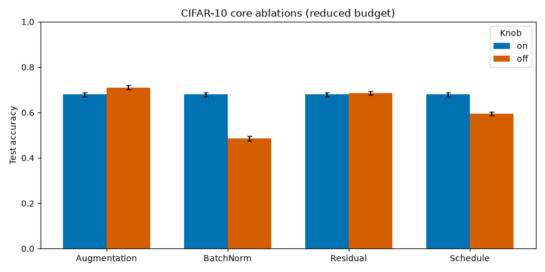

# CIFAR-10 core ablations — results

Status: full eight-run MPS suite complete. Committed summaries, reports, and
figures are in `results/ablations/`; the cross-pair comparison is in
`results/comparison/ablation_comparison.md`.

## Budget

- CIFAR-10 reduced split: 10,000 train / 2,000 validation; 10,000 test.
- Seed 42; 8 epochs; batch 128; AdamW 1e-3; weight decay 5e-4.
- Residual CNN with widths 32/64/128, dropout 0.2; 482,730 parameters.
- Training time was 17–20 s per run on MPS.

## Pair results

| Pair | On | Off | Difference | 95% CI overlap | Paired 95% CI |
|---|---|---|---|---|---|
| Augmentation | 67.92% | **71.06%** | off +3.14 pp | none | −3.90 to −2.42 pp |
| BatchNorm | **67.92%** | 48.55% | on +19.37 pp | none | +18.30 to +20.42 pp |
| Residual | 67.92% | **68.60%** | off +0.68 pp | substantial | −1.36 to +0.03 pp |
| Schedule | **67.92%** | 59.44% | cosine +8.48 pp | none | +7.60 to +9.40 pp |

The four “on” configs share the same base recipe, so their identical 67.92%
result is the controlled baseline for each pair, not four independent
findings.

## Full table

| Run | Test accuracy | 95% CI | Macro F1 |
|---|---:|---|---:|
| augmentation | 67.92% | 67.06–68.80% | 67.87% |
| none_augmentation | 71.06% | 70.19–71.91% | 70.96% |
| batchnorm | 67.92% | 67.06–68.80% | 67.87% |
| no_batchnorm | 48.55% | 47.58–49.46% | 47.32% |
| residual | 67.92% | 67.06–68.80% | 67.87% |
| no_residual | 68.60% | 67.75–69.47% | 68.52% |
| cosine | 67.92% | 67.06–68.80% | 67.87% |
| constant | 59.44% | 58.60–60.37% | 59.18% |

## Artifacts

- `results/ablations/<name>/reports/` — summary, evaluation, reports.
- `results/ablations/<name>/figures/` — training history, confusion matrix,
  per-class, calibration, model card, error gallery.
- `results/comparison/ablation_comparison.{md,json,png}` — cross-pair table and
  figure.

## Notes

- Per-run bootstrap intervals are recorded in each run's `summary.json`.
- No paired significance test was run; disjoint per-run intervals are
  suggestive, not a formal paired test. Overlapping intervals are not evidence
  of no effect.
- The augmentation result (off better on this budget) is a measured outcome, not
  a recommendation; the optical demo also avoids label-destroying augmentation.
- This is one seed and a reduced budget, not a universal ranking.
- Timings are measurements on the author's Apple M3 Max MPS machine, not
  guarantees.
