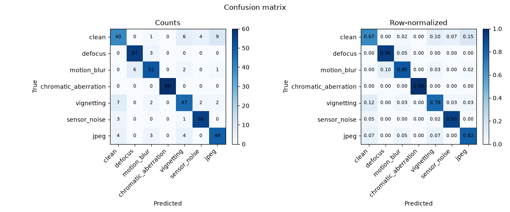

# Optical degradation classification — results

Status: full dataset and training run complete. Committed summaries, reports,
and figures are in `results/optics_degradation/`.

## Dataset

- 300 CIFAR-10 base images × 7 classes = 2,100 samples.
- Seven classes: clean, defocus, motion_blur, chromatic_aberration, vignetting,
  sensor_noise, jpeg.
- Group-aware split by base image: 180 train / 60 validation / 60 test base
  groups; 60 test samples per class.
- Seed 1; severity sampled per sample; no group leakage.
- Manifest digest: `32b7a72cb3c1e6b2`.

## Model and budget

- `simple_cnn`, channels 32/64/128, dropout 0.2, 94,375 parameters.
- 20 epochs, batch 64, AdamW 1e-3, cosine, early stopping patience 5.
- Device: Apple M3 Max MPS.

## Result

| Field | Value |
|---|---:|
| Best validation accuracy | 82.38% (epoch 16) |
| Test accuracy | **85.71%** |
| Test macro F1 | 85.57% |
| Test accuracy 95% CI | 82.38–88.81% |
| Training time | 7.5 s |
| Latency | 0.70 ms/image |

### Per-class test metrics

| Class | Precision | Recall | F1 | Support |
|---|---:|---:|---:|---:|
| clean | 74.07% | 66.67% | 70.18% | 60 |
| defocus | 90.48% | 95.00% | 92.68% | 60 |
| motion_blur | 85.00% | 85.00% | 85.00% | 60 |
| chromatic_aberration | 100.00% | 100.00% | 100.00% | 60 |
| vignetting | 78.33% | 78.33% | 78.33% | 60 |
| sensor_noise | 90.32% | 93.33% | 91.80% | 60 |
| jpeg | 80.33% | 81.67% | 80.99% | 60 |

## Artifacts

- `results/optics_degradation/reports/` — summary, evaluation, reports.
- `results/optics_degradation/figures/` — training history, confusion matrix,
  per-class metrics, calibration, model card, error gallery.
- `demos/optics_degradation/README.md` — generation and run instructions.

## Notes

- The clean class is the hardest: it is confused with subtle degradations.
- Chromatic aberration, defocus, and sensor noise are classified reliably at
  this resolution.
- The test split is held out until after training.
- The demo is a framework and diagnostics showcase, not a production
  image-quality benchmark; 32×32 synthetic degradations are subtle.
