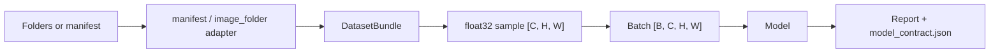
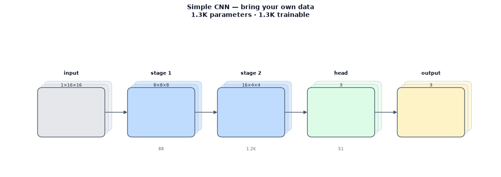

# Bring your own data

`cnn-classifier` is designed so that a new image-classification dataset is a
data adapter plus a YAML configuration, not a rewrite of the training loop. This
page shows the contract with the committed quickstart fixture.

## What you provide

A folder layout or a CSV manifest can describe the same data.

### Folder layout

```text
my_data/
├── train/
│   ├── class_a/*.png
│   ├── class_b/*.png
│   └── class_c/*.png
├── val/
│   └── ...
└── test/              # optional
```

Use `data.adapter: image_folder` and point `data.root` at `my_data`.

### Manifest

```csv
path,label,split,group
train/class_a/sample_001.png,class_a,train,subject_01
train/class_b/sample_002.png,class_b,train,subject_02
val/class_a/sample_003.png,class_a,val,subject_03
```

Use `data.adapter: manifest`, `data.manifest: manifest.csv`, and
`data.image_root: .`. The `group` column is optional but lets inspection catch
leakage across splits.

## Supported inputs

| Item | Supported |
|---|---|
| Bit depth | 8-bit RGB/grayscale; 16-bit grayscale PNG; 16-bit RGB/grayscale TIFF |
| Formats | PNG, TIFF, JPEG, BMP, WebP through Pillow/tifffile |
| Labels | folder names or manifest `label` |
| Split | folder names or manifest `split`; random, stratified, group, explicit |
| Class order | adapter order or `data.class_names` |
| Value range | automatic or fixed |
| Channels | `rgb`, `gray`, or `as_is` |

A 16-bit image is scaled from its full stored range to `float32` in `[0, 1]`;
it is not truncated to 8 bits. A 16-bit RGB PNG is rejected with a clear error
rather than silently downcast; use a 16-bit TIFF for multichannel 16-bit data.
The selected policy is recorded in the model contract and the report.

## What the model receives

| Contract field | Meaning |
|---|---|
| `dtype` | Always `float32` |
| one sample | `[C, H, W]` |
| one batch | `[B, C, H, W]` |
| `value_range` | `[0.0, 1.0]` after the configured scaling |
| `normalization` | mean/std, computed or supplied |
| `class_names` | ordered tuple used for the label map |
| `label_map` | class name → integer index |
| `channel_policy` | `rgb`, `gray`, or `as_is` |
| `stem_adaptation` | `None` here; may be set by a model config |



`data/model_contract.json` contains these fields, and both `inspect-data` and
`train --dry-run` print them before training.

## Model design



The fixture trains a small `simple_cnn` with 8/16 channels and 1,323
parameters. The schematic shows the grayscale input shape and the three-class
head; the exact contract is written to `data/model_contract.json`.

## The quickstart fixture

The committed demo is `demos/bring_your_own_data/`:

- 3 classes: `circle`, `square`, `stripe`;
- 60 images: 20 per class, 15 train / 5 validation;
- 16×16, 16-bit grayscale PNGs;
- seed 7; manifest with `path,label,split,group`;
- two epochs, batch 8, CPU/MPS auto.

```bash
python demos/bring_your_own_data/scripts/run_quickstart.py
```

The run finishes in a few seconds and writes a self-contained `report.html`.
See `demos/bring_your_own_data/README.md` for the exact fixture layout and the
raw-to-intake comparison.

## Quickstart result

The committed fixture reaches **60.00% validation accuracy** (macro F1 50.46%)
after two epochs, with 1,323 parameters and a training time of 0.26 s on MPS.
This is a pipeline smoke check, not an accuracy benchmark; the point is that the
raw-to-intake contract and the report path work end to end.

## Custom adapters

A new format can be registered from a demo module without editing the library:

```python
from cnn_classifier.core.types import DatasetBundle
from cnn_classifier.data.adapters import register_dataset


@register_dataset("my_format")
class MyFormatAdapter:
    @staticmethod
    def build(config) -> DatasetBundle:
        ...
```

Return the same `DatasetBundle` contract as the built-in adapters. The config,
trainer, evaluator, and report path then work unchanged.

## Common mistakes

- **Wrong class order.** `data.class_names` must match the adapter's index
  order; a mismatch fails loudly.
- **Wrong value range.** If your files store 12-bit data left-aligned in
  16 bits, use an explicit fixed range instead of `auto`.
- **Leakage across splits.** Put the source subject or scene in the `group`
  column and use the group split policy.
- **Test-set use during training.** The trainer never iterates the test loader;
  test is evaluated only through the explicit evaluate step.
