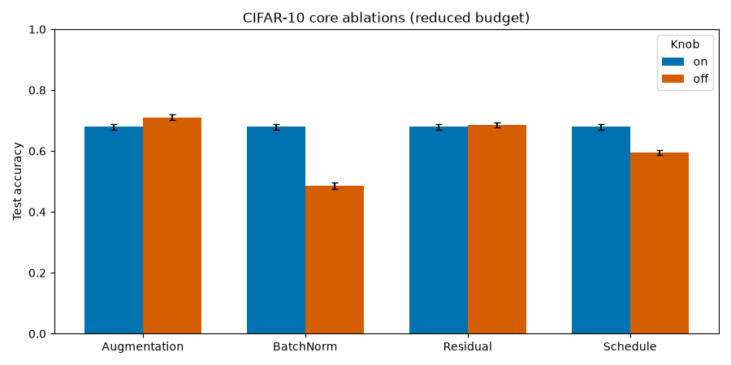

# Ablations

## Question

Which of four basic design choices matters under a fixed, reduced CIFAR-10
budget: augmentation, BatchNorm, residual connections, and the learning-rate
schedule?

## Protocol

- CIFAR-10 reduced split: 10,000 train / 2,000 validation, 10,000 test.
- Seed 42; 8 epochs; batch 128; AdamW 1e-3; weight decay 5e-4.
- Residual CNN with widths 32/64/128, dropout 0.2.
- Each pair changes exactly one knob; the shared `_base.yaml` makes that
  structural.

| Pair | On | Off |
|---|---|---|
| Augmentation | random crop + horizontal flip | tensor + normalize only |
| BatchNorm | `norm: batch` | `norm: none` |
| Residual | `residual: true` | `residual: false` |
| Schedule | cosine | constant |

## Result

The four “on” configs share the base recipe, so their identical 67.92% result is
the shared baseline for each pair.

| Pair | On | Off | Difference | CI overlap |
|---|---|---|---|---|
| Augmentation | 67.92% | **71.06%** | off +3.14 pp | none |
| BatchNorm | **67.92%** | 48.55% | on +19.37 pp | none |
| Residual | 67.92% | **68.60%** | off +0.68 pp | substantial |
| Schedule | **67.92%** | 59.44% | cosine +8.48 pp | none |

The comparison records per-run accuracy, macro F1, parameter count, training
time, and latency, with the per-run bootstrap interval in each `summary.json`.
The augmentation result (off better on this reduced budget) is measured, not a
recommendation.

- [Configs](https://github.com/pengzhao-ai/cnn-classifier/tree/main/configs/ablations)
- [Runner](https://github.com/pengzhao-ai/cnn-classifier/blob/main/demos/ablations/run_ablations.py)
- [Comparison](https://github.com/pengzhao-ai/cnn-classifier/blob/main/results/comparison/ablation_comparison.md)

## What to notice

- **One knob per pair.** A test asserts that the paired configs differ only in
  the intended field.
- **Same data and budget.** The subset limits are part of the data fingerprint.
- **Test is deferred.** All eight training runs finish before test is
  evaluated.
- **Compute is recorded.** A difference is read against training time, not just
  accuracy.

## Caveat

This is a reduced-budget study on one seed, not a definitive statistical claim.
Overlapping intervals are not evidence of no effect, and a single seed cannot
separate a small effect from seed noise. The study demonstrates the workflow
and the honest reporting, not a universal ranking of the techniques.
