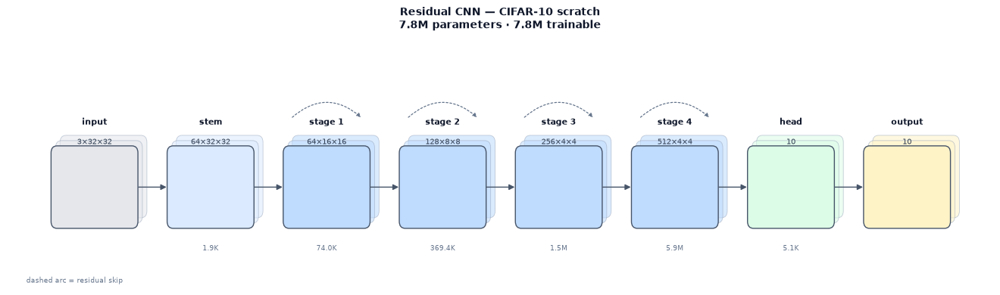
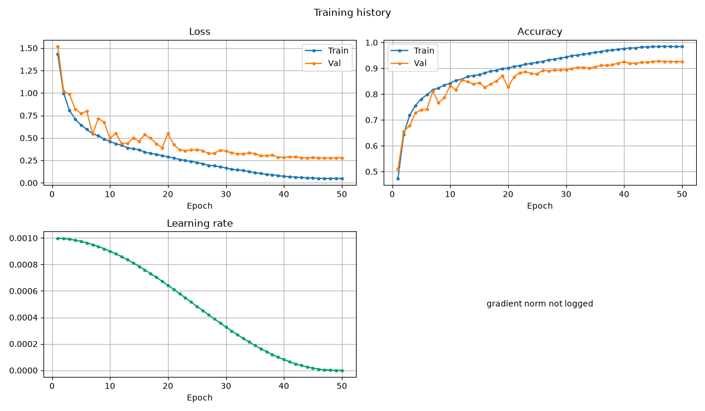
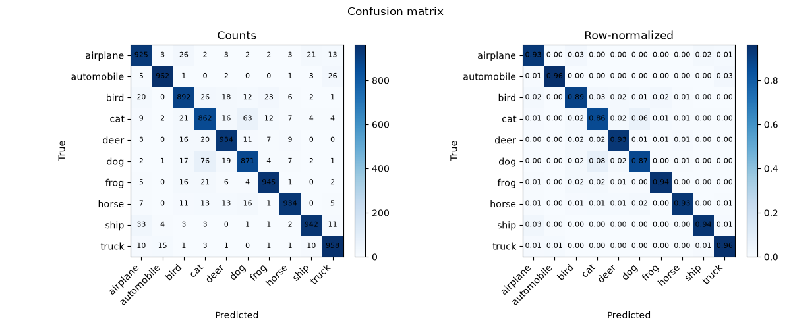
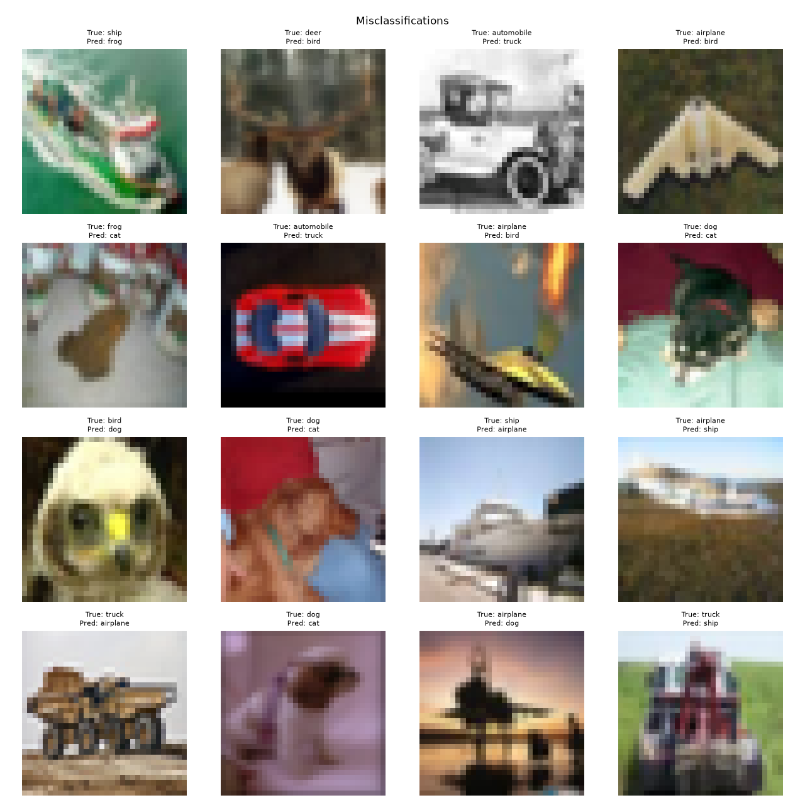
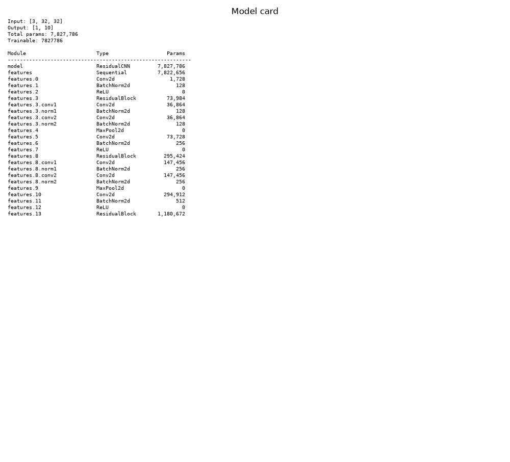

# CIFAR-10 scratch baseline

## Question

How well can a small residual CNN trained from scratch do on CIFAR-10 with a
plain, reproducible recipe — and does the library reproduce the reference result
without special-case code?

This is the reference baseline for the project. It is deliberately a standard
recipe, not a state-of-the-art submission: the point is a trustworthy,
config-driven training pipeline that reports its own behavior honestly.

## Protocol

| Component | Value |
|---|---|
| Data | CIFAR-10, 45,000 train / 5,000 validation / 10,000 test |
| Split | plain random, seed 42 |
| Model | `residual_cnn`, 3→64 stem, four stages, widths 64/128/256/512 |
| Parameters | 7,827,786 |
| Augmentation | flip, random crop (32, padding 4), mild color jitter, random erasing |
| Optimizer | Adam, lr 1e-3, weight decay 5e-4 |
| Schedule | cosine, no warmup, no gradient clipping |
| Budget | 50 epochs, batch 128, early stopping patience 10 |
| Device | Apple M3 Max MPS |

## Model design

The reference preset is a 7.8M-parameter residual CNN: a 3→64 stem, four
residual stages at widths 64/128/256/512, global average pooling, dropout 0.3,
and a linear head. The schematic shows the stage shapes and parameter counts;
the model card in the report lists every module.

## Result

| Field | Value |
|---|---:|
| Best validation accuracy | **92.78%** (epoch 46) |
| Test accuracy | **92.25%** |
| Test macro F1 | 92.26% |
| Test top-5 accuracy | 98.90% |
| Test accuracy 95% CI | 91.76–92.77% |
| Test NLL | 0.2894 |
| Calibration ECE | 0.0434 |
| Latency | 2.08 ms/image on MPS |
| Training time | 1,338 s (22.3 min) |

Reference: 92.42% validation / 92.61% test on MPS, seed 42. The test difference
is −0.36 percentage points; the validation difference is +0.36. The ≥90% gate is
met. No tuning was performed against the test split.

## Artifacts

The run directory contains `best.pt`, `last.pt`, the resolved config,
environment and git state, the data contract and fingerprints, history,
metrics, test predictions, figures, and self-contained HTML/Markdown reports.
Checkpoints stay local; committed result packaging lives under `results/`.

- [Demo source](https://github.com/pengzhao-ai/cnn-classifier/tree/main/demos/cifar10)
- [Config](https://github.com/pengzhao-ai/cnn-classifier/blob/main/configs/cifar10/scratch_baseline.yaml)
- [Measured results](https://github.com/pengzhao-ai/cnn-classifier/blob/main/demos/cifar10/results.md)

## What to notice

- **One YAML file describes the experiment.** The model is a generic
  `residual_cnn` preset, not a CIFAR-specific class.
- **The test split is isolated.** `Trainer.fit()` never iterates the test
  loader; test is evaluated once from the best validation checkpoint.
- **The result is reproducible.** Seed, environment, git state, and data
  fingerprint are recorded in the run.
- **The report is honest.** It shows calibration, per-class metrics, and the
  error gallery alongside accuracy.

## Caveat

This is a reference reproduction on one Apple Silicon machine, not a
state-of-the-art benchmark. CIFAR-10 is saturated; the interesting part is the
pipeline, the discipline, and the diagnostics.
