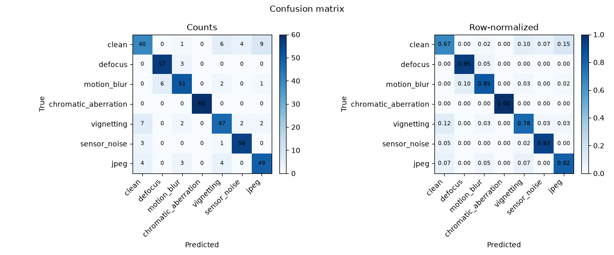
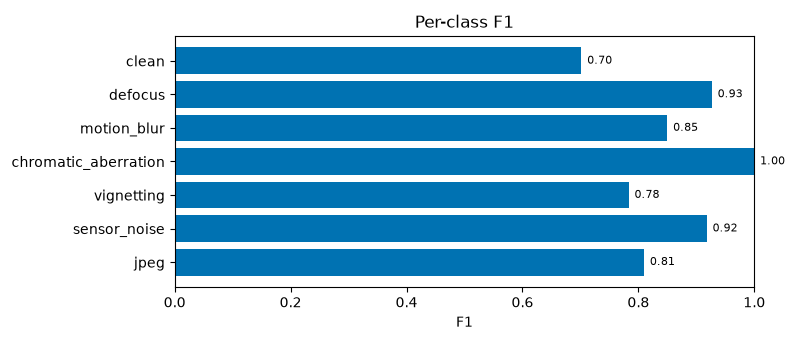

# Optical degradation

## Question

Can the toolkit classify the dominant optical degradation in an image, and does
the manifest adapter plus the reporting layer generalize beyond CIFAR-10?

This is a framework and diagnostics showcase. The images are 32×32 CIFAR-10
base images with synthetic degradations, so it is not a production
image-quality benchmark.

## Classes

| Label | Optical analogue | Implementation |
|---|---|---|
| `clean` | no dominant degradation | unchanged |
| `defocus` | defocused PSF | Gaussian blur |
| `motion_blur` | motion during exposure | oriented line kernel |
| `chromatic_aberration` | wavelength-dependent magnification | per-channel radial scale |
| `vignetting` | off-axis illumination falloff | radial gain mask |
| `sensor_noise` | photon and read noise | Gaussian + Poisson |
| `jpeg` | compression artifacts | JPEG round-trip |

Severity is sampled per sample from a configured range and written to the
manifest.

## Data and split

The generator uses selected CIFAR-10 training images as base images. Each base
image is a group; groups are assigned to train/validation/test before any
degraded sample is generated. The manifest records:

```text
path,label,split,group,severity
```

The manifest adapter reads the CSV and the explicit split column. The generator
is deterministic for a seed, and the `--quick` path uses fewer base images.

## Model and report

A small `simple_cnn` trains through the same trainer, evaluator, and report path
as the CIFAR demos. The report includes the confusion matrix, per-class metrics,
calibration, and an error gallery. The useful analysis is which degradations
are confused with which.

## Result

2,100 generated samples; 420 test samples (60 per class).

| Field | Value |
|---|---:|
| Test accuracy | 85.71% |
| Test macro F1 | 85.57% |
| Test accuracy 95% CI | 82.38–88.81% |
| Best validation accuracy | 82.38% (epoch 16) |
| Latency | 0.70 ms/image |

| Class | F1 | Support |
|---|---:|---:|
| clean | 70.18% | 60 |
| defocus | 92.68% | 60 |
| motion_blur | 85.00% | 60 |
| chromatic_aberration | 100.00% | 60 |
| vignetting | 78.33% | 60 |
| sensor_noise | 91.80% | 60 |
| jpeg | 80.99% | 60 |





Clean is the hardest class, as expected for subtle degradations at 32×32.
Chromatic aberration, defocus, and sensor noise are classified reliably.

- [Generator](https://github.com/pengzhao-ai/cnn-classifier/blob/main/demos/optics_degradation/generate_dataset.py)
- [Config](https://github.com/pengzhao-ai/cnn-classifier/blob/main/configs/optics_degradation/degradation_classifier.yaml)
- [Demo](https://github.com/pengzhao-ai/cnn-classifier/tree/main/demos/optics_degradation)
- [Results](https://github.com/pengzhao-ai/cnn-classifier/blob/main/results/optics_degradation/reports/summary.json)

## What to notice

- **A second dataset needs no code changes.** Only the adapter and config
  change.
- **Group leakage is checked before generation.** No base image appears in two
  splits.
- **The diagnostics are the point.** Confusion and calibration are more useful
  than a single accuracy number.
- **The caveat is explicit.** 32×32 synthetic degradations are a framework
  demonstration.

## Caveat

Some optical effects are subtle at 32×32. The demo does not claim production
image-quality performance; it shows that the data, training, evaluation, and
reporting layers generalize to a manifest-based task.
