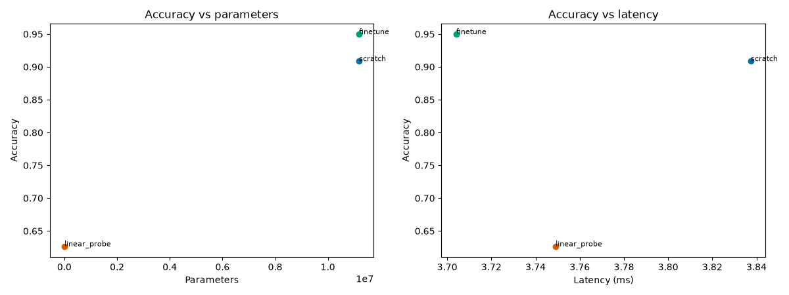

# Transfer benchmark

## Question

Does ImageNet pretraining help on 32×32 CIFAR-10, at what compute cost, and how
much of the benefit comes from the head versus the backbone?

The benchmark is a fairness anchor: three ResNet-18 runs with the same
architecture, data, augmentation, budget, and evaluation. Pretraining and
freezing are the changed variables.

## The three runs

| Config | Weights | Trainable | Budget |
|---|---|---|---|
| `resnet18_scratch_cifar.yaml` | none | all | 30 epochs, AdamW 1e-3, cosine, early stop 10 |
| `resnet18_linear_probe_cifar.yaml` | ImageNet | head only | max 30 epochs, AdamW head 1e-3, early stop 10 |
| `resnet18_finetune_cifar.yaml` | ImageNet | all | 30 epochs, backbone 1e-4 / head 1e-3 |

All three use `keep_7x7_stride1` so the stem sees 32×32 inputs without changing
the architecture between runs. The linear probe freezes the entire backbone,
including the pretrained stem, so its features are genuinely ImageNet features.
Its head has exactly 5,130 trainable parameters before training.

## Normalization difference

The transfer anchor uses ImageNet mean/std because the pretrained model expects
it. The scratch reference baseline uses CIFAR mean/std. That difference is
labeled in the comparison, not hidden: the anchor answers a different question
from the reference reproduction.

## Result

All three runs share the CIFAR-10 test set and test fingerprint.

| Run | Test accuracy | 95% CI | Macro F1 | Trainable params | Train time |
|---|---:|---|---:|---:|---:|
| Scratch | 90.88% | 90.33–91.43% | 90.90% | 11,181,642 | 19.6 min |
| Linear probe | 62.66% | 61.75–63.63% | 62.54% | 5,130 | 8.4 min |
| Fine-tune | **94.98%** | 94.57–95.41% | 94.97% | 11,181,642 | 19.5 min |

The comparison records test fingerprints, per-run bootstrap intervals,
parameter counts, training time, latency, and peak memory. BatchNorm running
statistics update even while probe parameters are frozen, so the linear probe
is a frozen-parameter probe, not a strict frozen-feature probe.

- [Runner](https://github.com/pengzhao-ai/cnn-classifier/blob/main/demos/cifar10/scripts/run_transfer.py)
- [Configs](https://github.com/pengzhao-ai/cnn-classifier/tree/main/configs/cifar10)
- [Comparison](https://github.com/pengzhao-ai/cnn-classifier/blob/main/results/comparison/transfer_comparison.md)

## What to notice

- **Same data and budget.** The fairness anchor is structural: shared split,
  augmentation, epochs, and evaluation.
- **Test evaluation is deferred.** All three runs train first with test
  evaluation disabled; test is evaluated only after the suite completes.
- **Compute is part of the result.** A model that wins by a fraction of a point
  while costing much more training time is reported as such.
- **No significance claim from overlap.** Per-run intervals are reported; a
  paired test is required for a real significance claim.

## Caveat

This is a single 32×32 protocol, not a universal statement about transfer
learning. The 224×224 tracks and budget-sensitivity sweep are deferred to
v1.1. Results from the reference baseline and the transfer anchor are separate
and should not be merged into one leaderboard.
