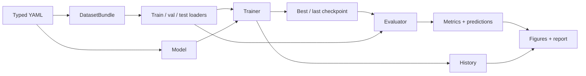
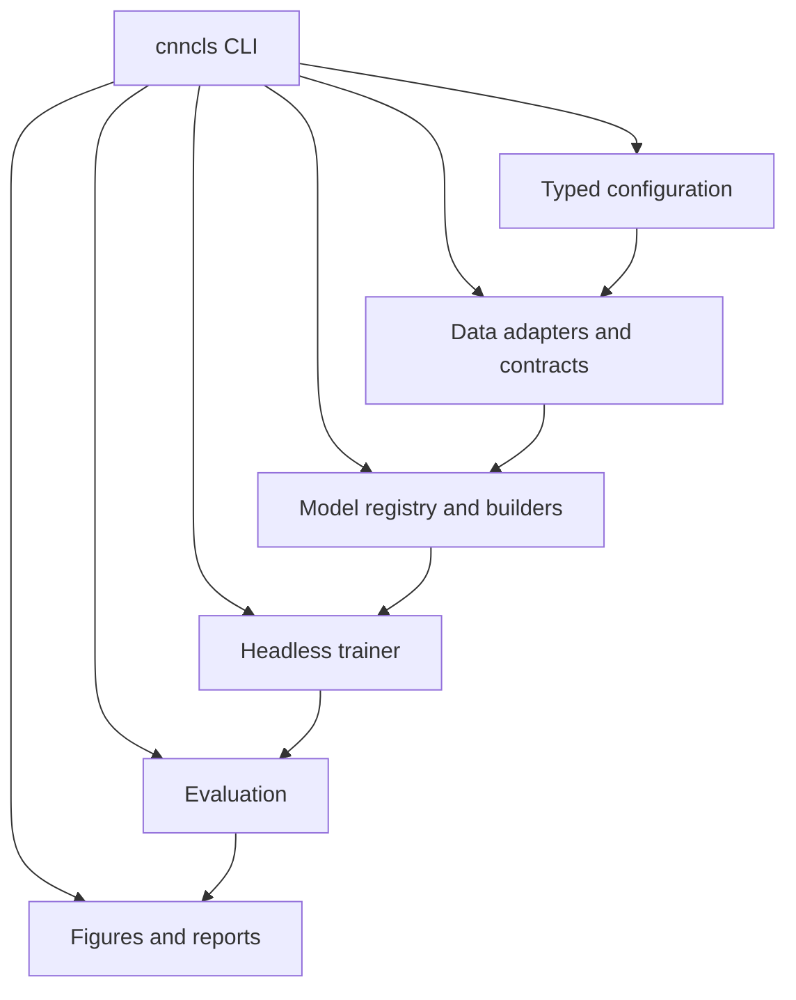

# How it works

## The short version

A run is a chain of explicit contracts:



Every arrow is a tested interface. The configuration describes the experiment;
the data adapter produces a `DatasetBundle`; the model registry builds a
`torch.nn.Module`; the trainer fits it; the evaluator produces metrics and
predictions; the report reads the run directory.



The arrows show dependency direction. The CLI is the orchestration layer; the
library modules below it stay decoupled so training remains headless.

## Module boundaries

| Layer | Package | Responsibility | Must not import |
|---|---|---|---|
| Configuration | `cnn_classifier.config` | Pydantic schema, YAML merge, overrides, validation | data, models, training |
| Core | `cnn_classifier.core` | errors, registry, device, seeding, hashing, shared types | any higher layer |
| Data | `cnn_classifier.data` | adapters, splits, image I/O, normalization, transforms, loaders, inspection | models, training |
| Models | `cnn_classifier.models` | builders, residual/simple CNN, torchvision wrapper, transfer helpers | training, evaluation, viz |
| Training | `cnn_classifier.training` | trainer, callbacks, optimizer/scheduler, loss, AMP, checkpoints | evaluation, viz, matplotlib, jinja2 |
| Evaluation | `cnn_classifier.evaluation` | metrics, calibration, bootstrap, error analysis, latency, comparison | training loop internals |
| Diagnostics | `cnn_classifier.diagnostics` | overfit, tracing, gradients, activations, determinism | viz |
| Tracking / runs | `cnn_classifier.runs`, `cnn_classifier.tracking` | run directory, environment, git state, CSV/TensorBoard | viz |
| Viz / report | `cnn_classifier.viz` | style, figures, model card, HTML/Markdown report | training |
| CLI | `cnn_classifier.cli` | orchestration and user-facing commands | — |

The one-way rules keep training headless and reports artifact-driven. A test
checks that importing `cnn_classifier.training` does not pull in the plotting
stack.

## The run lifecycle

1. **Load and validate** the YAML, defaults chain, and CLI overrides.
2. **Resolve paths** relative to the experiment file and validate cross-field
   semantics.
3. **Build the dataset** adapter, split, normalization, transforms, and model
   contract.
4. **Build loaders** with seeded shuffling and a device-aware worker policy.
5. **Build the model** from the registry and apply transfer controls.
6. **Train** with callbacks, checkpoints, and optional AMP.
7. **Evaluate** the held-out split from the best checkpoint.
8. **Write artifacts**: resolved config, environment, git state, fingerprints,
   history, metrics, predictions, figures, and the report.

## The run directory

A completed run is self-describing:

```text
runs/<timestamp>_<experiment>_<hash>/
├── config.resolved.yaml
├── environment.json
├── git.json
├── data/
│   ├── class_names.json
│   ├── fingerprint.json
│   ├── model_contract.json
│   ├── normalization.json
│   └── splits.json
├── checkpoints/
│   ├── best.pt
│   └── last.pt
├── history.csv
├── metrics.jsonl
├── summary.json
├── evaluation.json
├── predictions/
├── figures/
├── report.html
├── report.md
├── model_summary.json
└── status.json
```

`best.pt` is selected by validation accuracy, not test accuracy. `last.pt` is
resumable. Checkpoints are not committed.

## Reproducibility and test discipline

- Seeds cover split generation, augmentation, model initialization, and
  bootstrap resampling.
- The environment and git state are captured in every run.
- The data fingerprint identifies the split; comparisons refuse mismatched test
  fingerprints.
- `Trainer.fit()` never iterates the test loader. Test is an explicit
  evaluation step.
- Full-runs are documented with device, seed, and timing; timings are
  measurements, not guarantees.

## Where to go next

- [Configuration](configuration.md) for the YAML contract.
- [Models & architectures](models.md) for the built-in families.
- [Techniques](techniques/augmentation.md) for the method details.
- [API](api.md) for the generated library reference.
