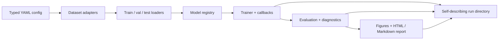

# cnn-classifier

A config-driven, reproducible PyTorch toolkit for CNN image classification.

`cnn-classifier` turns a new image/label dataset into a trained, evaluated, and
reported classifier through a typed YAML configuration. The same library powers
the command line, so a quick smoke test and a full experiment use one pipeline.

!!! note "Sharp v1"
    The core library, CLI, evaluation stack, diagnostics, report generator, and
    the five demo suites are implemented. The CIFAR-10 scratch baseline has been
    reproduced on Apple Silicon MPS; the transfer, ablation, and optical runs are
    scheduled for the final benchmark stage.

## Results at a glance

| Experiment | Result | Budget | Status |
|---|---:|---|---|
| CIFAR-10 scratch baseline | **92.25% test**, 92.78% best validation | 50 epochs, 22.3 min MPS | reproduced |
| Three 32×32 ResNet-18 transfer runs | pending | 30 epochs each | benchmark stage |
| Four core ablations | pending | 8 epochs, 10k train subset | benchmark stage |
| Optical degradation classifier | pending | 20 epochs | benchmark stage |
| Bring-your-own-data quickstart | contract verified | 2 epochs, under a minute | complete |

Reference for the scratch baseline: 92.42% validation / 92.61% test on MPS,
seed 42. The reproduced test result is within 0.4 percentage points and clears
the ≥90% acceptance gate. See [Results](results.md) for the environment and
caveats.

## What it is

- **One configuration contract.** Every experiment is a validated YAML file.
  Unknown keys fail; CLI overrides use the same schema.
- **One data contract.** Adapters produce `float32 [C, H, W]` samples, integer
  labels, and a written model contract.
- **One artifact contract.** A run directory is self-describing: resolved
  config, environment, git state, fingerprints, checkpoints, metrics,
  predictions, figures, and a report.
- **Test discipline.** Training never iterates the test loader; test is
  available only through an explicit evaluation step.

## Architecture



The dependency rule is one-way: configuration and data do not import the
training loop; training does not import plotting. Reporting reads run artifacts.
See [How it works](how_it_works.md) for the module boundaries.

## Quickstart

```bash
make sync
source .venv/bin/activate
cnncls doctor
cnncls train -c configs/tests/synthetic.yaml --set training.epochs=1
```

The synthetic run needs no download. For the real-data path:

```bash
python demos/bring_your_own_data/scripts/run_quickstart.py
python demos/cifar10/scripts/run_scratch.py --quick
```

## Demos

| Demo | What it shows | Entry point |
|---|---|---|
| [CIFAR-10 scratch](https://github.com/pengzhao-ai/cnn-classifier/tree/main/demos/cifar10) | reference residual CNN and full training path | `demos/cifar10/scripts/run_scratch.py` |
| [Transfer benchmark](https://github.com/pengzhao-ai/cnn-classifier/tree/main/configs/cifar10) | scratch vs linear probe vs fine-tune at 32×32 | `demos/cifar10/scripts/run_transfer.py` |
| [Ablations](https://github.com/pengzhao-ai/cnn-classifier/tree/main/demos/ablations) | four controlled pairs on a reduced CIFAR split | `demos/ablations/run_ablations.py` |
| [Optical degradation](https://github.com/pengzhao-ai/cnn-classifier/tree/main/demos/optics_degradation) | manifest data, group-safe splits, confusion analysis | `demos/optics_degradation/scripts/run_optics.py` |
| [Bring your own data](bring_your_own_data.md) | raw-to-intake contract and custom adapters | `demos/bring_your_own_data/scripts/run_quickstart.py` |

## Documentation map

- [Quickstart](quickstart.md) — install, verify, run the first experiments.
- [How it works](how_it_works.md) — module boundaries and the run lifecycle.
- [Models & architectures](models.md) — registry, CNN presets, torchvision transfer.
- [Configuration](configuration.md) — schema, defaults, overrides, validation.
- [Techniques](techniques/augmentation.md) — augmentation, optimization, transfer,
  evaluation rigor, efficiency and diagnostics.
- [Results](results.md) — measured numbers, environment, and caveats.
- [Extending](extending.md) — custom adapters, models, transforms.
- [CLI](cli.md) and [API](api.md) — command and library reference.

## Positioning

This is a modern, reproducible, well-diagnosed CNN training toolkit. It is not a
state-of-the-art benchmark submission, a model zoo, or a notebook collection.
The demos are chosen to exercise the engineering, not to win a leaderboard.
