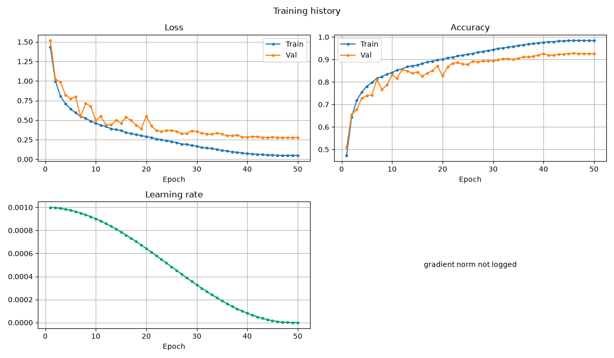
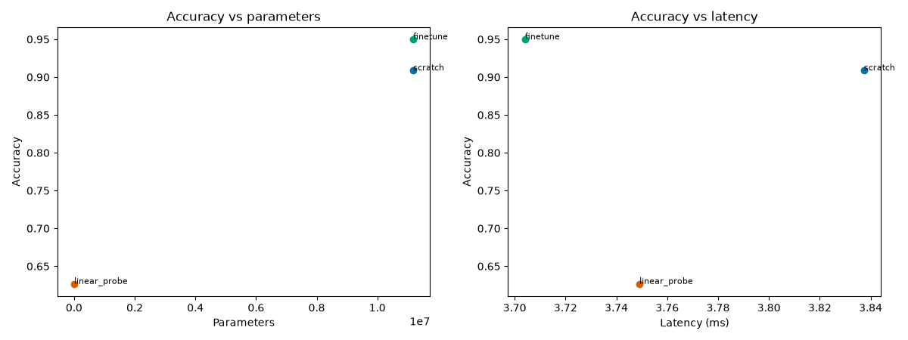
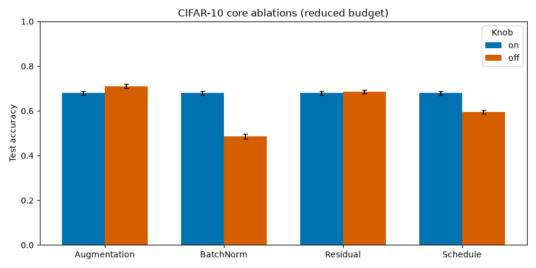
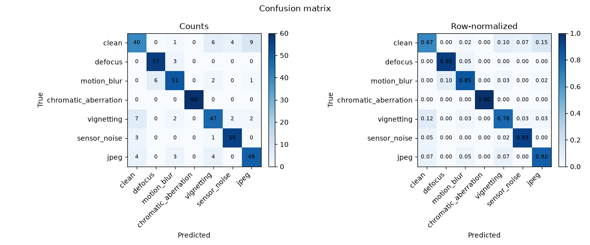
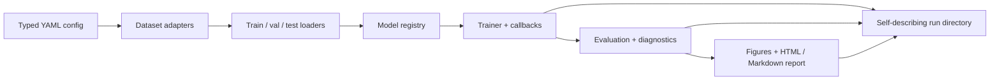

# CNN Classifier Toolkit

A config-driven, reproducible PyTorch toolkit for CNN image classification.

The toolkit turns a new image/label dataset into a trained, evaluated, and
reported classifier through a typed YAML configuration. The same library powers
the command line, so a quick smoke test and a full experiment use one pipeline.
It ships with a complete reference implementation, five demos, and committed
results from a measured Apple Silicon MPS run.

It is published on PyPI as `cnn-classifier-toolkit`; the import package remains
`cnn_classifier` and the CLI remains `cnncls`.

## Results at a glance

| Experiment | Result | Budget |
|---|---:|---|
| CIFAR-10 scratch baseline | **92.25% test**, 92.78% best validation | 50 epochs, 22.3 min MPS |
| ResNet-18 fine-tune, 32×32 | **94.98% test** | 30 epochs, 19.5 min MPS |
| ResNet-18 scratch, 32×32 | 90.88% test | 30 epochs, 19.6 min MPS |
| ResNet-18 linear probe | 62.66% test | 30 epochs, 8.4 min MPS |
| Four core ablations | BN on +19.4 pp; cosine +8.5 pp; residual off +0.7 pp; augmentation off +3.1 pp | 8 epochs, 10k train subset |
| Optical degradation classifier | 85.71% test | 20 epochs, 7.5 s MPS |
| Bring-your-own-data quickstart | contract verified | 2 epochs, under a minute |

Reference for the scratch baseline: 92.42% validation / 92.61% test on MPS,
seed 42. The reproduced test result is within 0.4 percentage points and clears
the ≥90% acceptance gate. See the [CIFAR-10 case study](case_studies/cifar10.md)
for the environment and caveats.

<div class="grid cards" markdown>

-   

    **CIFAR-10 baseline**

    A 7.8M-parameter residual CNN trained from scratch to 92.25% test accuracy.

-   

    **Transfer benchmark**

    Scratch, linear probe, and fine-tune at 32×32; fine-tuning gains 4.1 pp
    over scratch.

-   

    **Controlled ablations**

    Four paired experiments isolate augmentation, BatchNorm, residuals, and the
    learning-rate schedule.

-   

    **Optical degradations**

    Seven synthetic degradation classes with a group-safe split and confusion
    analysis.

</div>

## What it is

- **One configuration contract.** Every experiment is a validated YAML file.
  Unknown keys fail; CLI overrides use the same schema.
- **One data contract.** Adapters produce `float32 [C, H, W]` samples, integer
  labels, and a written model contract.
- **One artifact contract.** A run directory is self-describing: resolved
  config, environment, git state, fingerprints, checkpoints, metrics,
  predictions, figures, and a report.
- **Test discipline.** Training never iterates the test loader; test is
  available only through an explicit evaluation step.

## Architecture



The dependency rule is one-way: configuration and data do not import the
training loop; training does not import plotting. Reporting reads run artifacts.
See [How it works](how_it_works.md) for the module boundaries.

## Quickstart

```bash
make sync
source .venv/bin/activate
cnncls doctor
cnncls train -c configs/tests/synthetic.yaml --set training.epochs=1
```

The synthetic run needs no download. For the real-data path:

```bash
python demos/bring_your_own_data/scripts/run_quickstart.py
python demos/cifar10/scripts/run_scratch.py --quick
```

## Demos

| Demo | What it shows | Entry point |
|---|---|---|
| [CIFAR-10 scratch](https://github.com/pengzhao-ai/cnn-classifier/tree/main/demos/cifar10) | reference residual CNN and full training path | `demos/cifar10/scripts/run_scratch.py` |
| [Transfer benchmark](https://github.com/pengzhao-ai/cnn-classifier/tree/main/configs/cifar10) | scratch vs linear probe vs fine-tune at 32×32 | `demos/cifar10/scripts/run_transfer.py` |
| [Ablations](https://github.com/pengzhao-ai/cnn-classifier/tree/main/demos/ablations) | four controlled pairs on a reduced CIFAR split | `demos/ablations/run_ablations.py` |
| [Optical degradation](https://github.com/pengzhao-ai/cnn-classifier/tree/main/demos/optics_degradation) | manifest data, group-safe splits, confusion analysis | `demos/optics_degradation/scripts/run_optics.py` |
| [Bring your own data](bring_your_own_data.md) | raw-to-intake contract and custom adapters | `demos/bring_your_own_data/scripts/run_quickstart.py` |

## Documentation map

- [How it works](how_it_works.md) — architecture, data and configuration,
  models, techniques, and extending.
- [Demos](case_studies/cifar10.md) — CIFAR-10, transfer, ablations, optical
  degradation, and bring-your-own-data.
- [Reference](cli.md) — CLI and API.
- [Quickstart](quickstart.md) — install, verify, run the first experiments.

## Positioning

This is a modern, reproducible, well-diagnosed CNN training toolkit. It is not a
state-of-the-art benchmark submission, a model zoo, or a notebook collection.
The demos are chosen to exercise the engineering, not to win a leaderboard.
