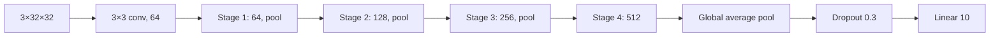
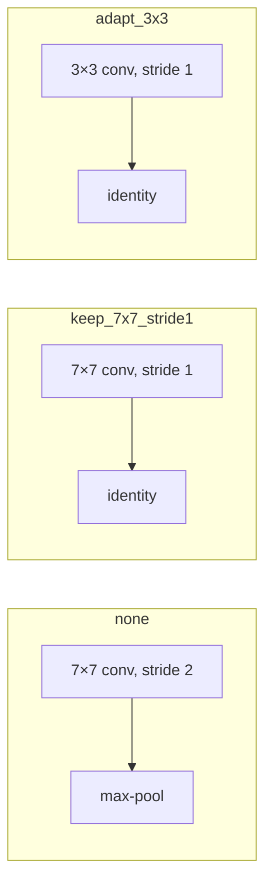

# Models & architectures

## The registry

Models are built from `model.name` and validated `model.params` through a
registry. A custom builder registers itself and receives a `ModelBuildContext`
with the number of classes, input channels, image size, and transfer settings.

```yaml
model:
  name: residual_cnn
  params: { ... }
```

The CLI and library both call `build_model`; there is no separate model path for
demos.

## `simple_cnn`

A small stacked CNN for quick experiments and tiny datasets.

```yaml
model:
  name: simple_cnn
  params:
    channels: [32, 64, 128]
    dropout: 0.2
    norm: batch       # batch | none
```

Each channel entry is a convolution, optional BatchNorm, ReLU, and max-pool. A
global average pool and dropout feed the linear head. The optics quickstart uses
this family.

## `residual_cnn`

A configurable residual CNN with an explicit stem and stage description. It is
not a CIFAR-specific class; the reference preset is a config.

```yaml
model:
  name: residual_cnn
  params:
    stem: {channels: 64, kernel_size: 3, stride: 1, pool: false}
    stages:
      - {channels: 64, conv: false, blocks: 1, downsample: maxpool}
      - {channels: 128, conv: true, blocks: 1, downsample: maxpool}
      - {channels: 256, conv: true, blocks: 1, downsample: maxpool}
      - {channels: 512, conv: true, blocks: 1, downsample: none}
    dropout: 0.3
    norm: batch       # batch | none
    residual: true
```

| Reference preset | Value |
|---|---:|
| Parameters | 7,827,786 |
| Stem | 3→64, 3×3, stride 1 |
| Stages | 64 / 128 / 256 / 512 |
| Blocks per stage | 1 |
| Downsampling | max-pool after stages 1–3 |
| Head | global average pool, dropout 0.3, linear |



The same builder covers the ablation pairs: `norm: none` removes BatchNorm and
`residual: false` turns each block into a plain two-convolution stack.

## `torchvision`

A thin wrapper around `torchvision.models.get_model`, with a replaced
task-specific classifier and optional stem adaptation.

```yaml
model:
  name: torchvision
  params:
    model: resnet18
    stem_adaptation: keep_7x7_stride1
    dropout: 0.0
  transfer:
    weights: IMAGENET1K_V1
    freeze: none
```

### Stem adaptation

| Mode | Behavior | Use |
|---|---|---|
| `none` | unchanged stem, including 7×7 stride 2 and max-pool | 224×224 tracks |
| `keep_7x7_stride1` | stride 1, max-pool replaced by identity | 32×32 fairness anchor |
| `adapt_3x3` | 3×3 conv initialized from the center of the 7×7 kernel, stride 1, no max-pool | optional ablation |

A frozen `adapt_3x3` stem is rejected: the uninitialized stem would block
ImageNet features.



### Transfer modes

| `freeze` | Trainable parameters | Typical use |
|---|---|---|
| `none` | all | scratch control or fine-tune |
| `backbone` | classifier head only | linear probe |
| `all_but_head` | classifier head only | alias for backbone freeze |
| `train_bn` | BatchNorm parameters too when frozen | optional BN policy |

Differential learning rates use regex parameter groups, for example a 10× head
rate:

```yaml
transfer:
  weights: IMAGENET1K_V1
  freeze: none
  param_groups:
    - pattern: '^fc\.'
      lr_multiplier: 10.0
```

Every pattern must match at least one trainable parameter; silent no-ops are
rejected.

## Summaries and model cards

`model_summary` reports parameter counts and layer shapes. The report writes a
model card figure with the architecture and total/trainable counts, so a run's
model is inspectable without reading the YAML.

## Where to go next

- [Transfer learning](techniques/transfer.md) for the fairness protocol.
- [Configuration](configuration.md) for the exact keys.
- [CIFAR-10 scratch](case_studies/cifar10.md) for the reference preset in
  context.
