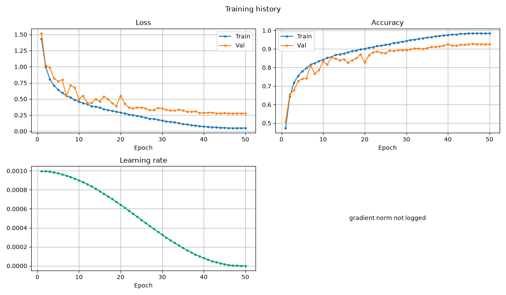
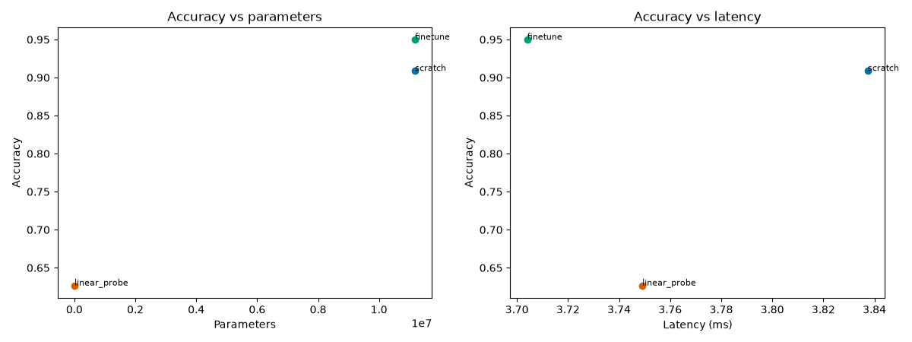
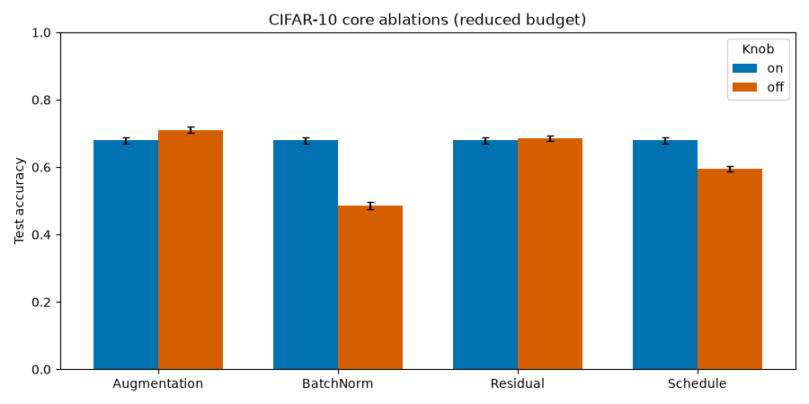
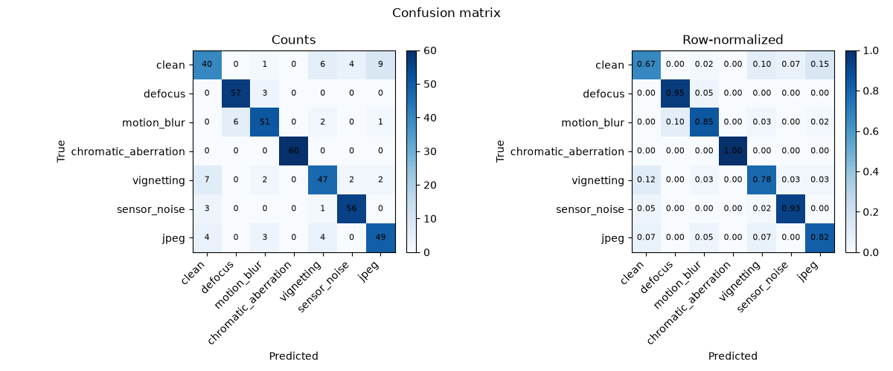

# Results

This page is the single source for committed benchmark numbers. Demo pages own
the narrative; this page owns the comparison and the environment.

## Environment

| Field | Value |
|---|---|
| Machine | Apple M3 Max, macOS 27.0.1 arm64 |
| Device | MPS |
| Python | 3.11.8 |
| PyTorch | 2.15.0 |
| TorchVision | 0.29.2 |
| Reference seed | 42 |

The CIFAR-10 scratch baseline uses seed 42; the transfer and ablation runs use
seed 42; the optics demo uses seed 1. All timings are measurements on this
machine, not guarantees.

## Benchmark table

| Experiment | Test accuracy | Macro F1 | Params | Training time | Status |
|---|---:|---:|---:|---:|---|
| CIFAR-10 scratch baseline | **92.25%** | 92.26% | 7,827,786 | 1,338 s | measured |
| ResNet-18 scratch, 32×32 | 90.88% | 90.90% | 11,181,642 | 1,173 s | measured |
| ResNet-18 linear probe | 62.66% | 62.54% | 5,130 trainable | 504 s | measured |
| ResNet-18 fine-tune | **94.98%** | 94.97% | 11,181,642 | 1,169 s | measured |
| Optical degradation | 85.71% | 85.57% | 94,375 | 7.5 s | measured |
| Bring-your-own-data quickstart | 60.00% val | 50.46% | 1,323 | 0.26 s | smoke |

## CIFAR-10 scratch baseline detail

| Field | Value |
|---|---:|
| Best validation accuracy | 92.78% (epoch 46) |
| Test accuracy 95% CI | 91.76–92.77% |
| Top-5 accuracy | 98.90% |
| NLL | 0.2894 |
| ECE | 0.0434 |
| Latency | 2.08 ms/image |
| MPS memory (allocated) | 121.0 MB |

Reference: 92.42% validation / 92.61% test. The reproduced test result is
−0.36 percentage points from the reference and above the ≥90% gate. No test-set
tuning was performed.

## Transfer benchmark

All three runs share the CIFAR-10 test set and test fingerprint
`7aac74439fdc9640`.

| Run | Test accuracy | 95% CI | Macro F1 | Trainable params |
|---|---:|---|---:|---:|
| Scratch | 90.88% | 90.33–91.43% | 90.90% | 11,181,642 |
| Linear probe | 62.66% | 61.75–63.63% | 62.54% | 5,130 |
| Fine-tune | **94.98%** | 94.57–95.41% | 94.97% | 11,181,642 |

Paired bootstrap on the shared test predictions:

| Comparison | Difference | 95% CI |
|---|---:|---|
| Fine-tune − scratch | +4.10 pp | +3.49 to +4.69 pp |
| Fine-tune − linear probe | +32.32 pp | +31.35 to +33.23 pp |
| Linear probe − scratch | −28.22 pp | −29.19 to −27.21 pp |

The scratch control uses ImageNet normalization to match the pretrained input
contract; the reference CIFAR baseline uses CIFAR normalization. BatchNorm
running statistics update even while probe parameters are frozen, so the
linear probe is not a strict frozen-feature probe.

## Core ablations

Reduced split: 10,000 train / 2,000 validation, 10,000 test; seed 42; 8 epochs;
482,730 parameters. The four “on” configs share the base recipe, so their
identical 67.92% result is the shared baseline for each pair.

| Pair | On | Off | Difference | CI overlap |
|---|---|---|---|---|
| Augmentation | 67.92% | **71.06%** | off +3.14 pp | none |
| BatchNorm | **67.92%** | 48.55% | on +19.37 pp | none |
| Residual | 67.92% | **68.60%** | off +0.68 pp | substantial |
| Schedule | **67.92%** | 59.44% | cosine +8.48 pp | none |

Paired bootstrap (on − off):

| Pair | Difference | 95% CI |
|---|---:|---|
| Augmentation | −3.14 pp | −3.90 to −2.42 pp |
| BatchNorm | +19.37 pp | +18.30 to +20.42 pp |
| Residual | −0.68 pp | −1.36 to +0.03 pp |
| Schedule | +8.48 pp | +7.60 to +9.40 pp |

The augmentation result is a measured outcome on this reduced budget, not a
recommendation. No paired significance test was run.

## Optical degradation

Seven-class classification on 2,100 generated samples; 420 test samples.

| Field | Value |
|---|---:|
| Test accuracy | 85.71% |
| Test macro F1 | 85.57% |
| Test accuracy 95% CI | 82.38–88.81% |
| Best validation accuracy | 82.38% (epoch 16) |
| Latency | 0.70 ms/image |

Clean is the hardest class (F1 70.18%); chromatic aberration is perfect at this
resolution, and defocus and sensor noise exceed 91% F1. See the
[case study](case_studies/optics_degradation.md) for the class table.

## Artifact policy

- `runs/` is gitignored; checkpoints and raw datasets are not committed.
- `results/<demo>/` holds committed summaries, figures, and reports.
- `results/comparison/` holds the cross-run transfer and ablation tables.
- `docs/images/` mirrors selected figures; a test checks byte-identical copies.
- Timings are measurements, not guarantees.

The packaging is reproducible: after rerunning the demos, run
`python scripts/package_results.py` and `python scripts/make_comparisons.py`.
See `scripts/README.md` for details.

## Caveats

- The transfer and ablation studies use one seed and a single architecture
  family; they are controlled demonstrations, not definitive rankings.
- Per-run bootstrap intervals are not paired significance tests.
- The linear probe's BatchNorm statistics move during training, so it is a
  frozen-parameter probe rather than a strict frozen-feature probe.
- MPS kernel behavior can vary across library versions; the environment is
  recorded with every run.
- The project is a modern, reproducible, well-diagnosed toolkit, not a
  state-of-the-art benchmark submission.
