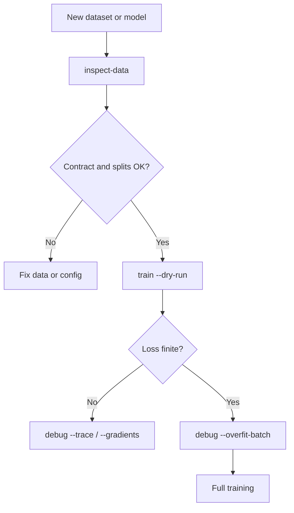

# Efficiency & diagnostics

## What

Before a long run, the toolkit can inspect the data contract, overfit a single
batch, trace shapes, report gradient and activation statistics, and check
determinism. Runtime policy covers device selection, worker count, pinned
memory, channels-last, and optional compilation.

## Why

Most failed training runs fail before the first epoch: a wrong label map, a
silently truncated 16-bit image, a model that cannot learn a single batch, or a
non-deterministic pipeline. Cheap diagnostics catch those before compute is
spent.

## Config keys

| Knob | Config key | Notes |
|---|---|---|
| Device | `runtime.device` | `auto`, `cuda`, `mps`, `cpu` |
| Determinism | `runtime.deterministic` | seeds and deterministic kernels |
| Workers | `runtime.num_workers` | `auto` respects device |
| Pin memory | `runtime.pin_memory` | `auto` enables on CUDA |
| Channels last | `runtime.channels_last` | memory format |
| Compile | `runtime.compile` | disabled by default |

CLI diagnostics:

```bash
cnncls inspect-data -c config.yaml
cnncls debug -c config.yaml --overfit-batch --steps 20
cnncls debug -c config.yaml --trace
cnncls debug -c config.yaml --gradients
cnncls debug -c config.yaml --determinism
```



## Implementation

`diagnostics.overfit_batch` repeatedly fits one batch; `tracing` records shapes;
`gradients` and `activations` summarize per-layer statistics; `determinism`
repeats a seeded step and compares outputs. `data.loaders` chooses zero workers
on MPS, four on Linux CUDA, and two on CPU, unless the config overrides it.

## Evidence

- The CIFAR-10 dry-run builds the real split, runs one forward/backward pass,
  and reports one batch loss without writing a run.
- The synthetic debug path is covered by tests for overfit, trace, gradients,
  and determinism.
- On the author's M3 Max, `device: auto` resolves to MPS and worker count
  resolves to 0; the full CIFAR baseline took 1,338 s.
- The inspection report catches duplicate content, corrupt files, split overlap,
  and group leakage.

## Caveat

Diagnostics are indicators, not guarantees. A successful one-batch overfit does
not prove generalization, and a determinism check on one step does not prove an
entire run is bit-reproducible. MPS kernel behavior can differ across library
versions; record the environment with the result.
